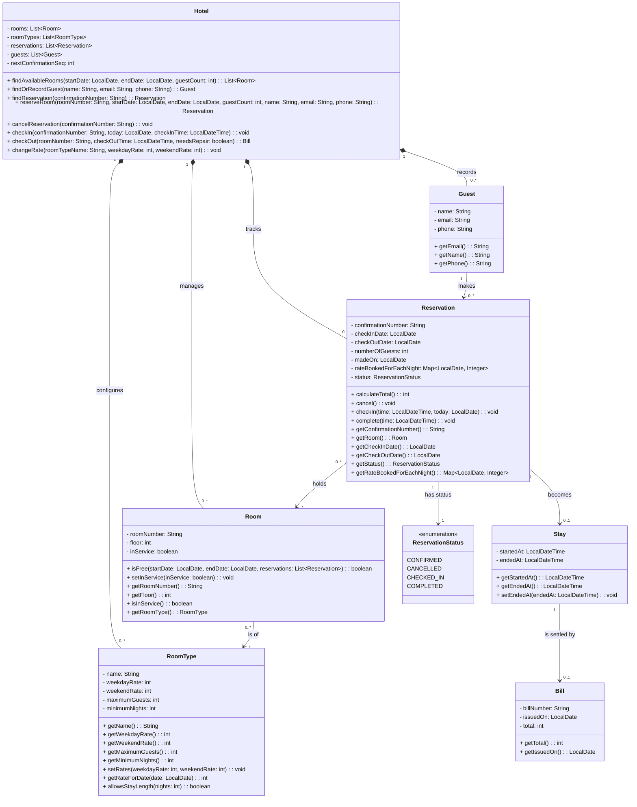
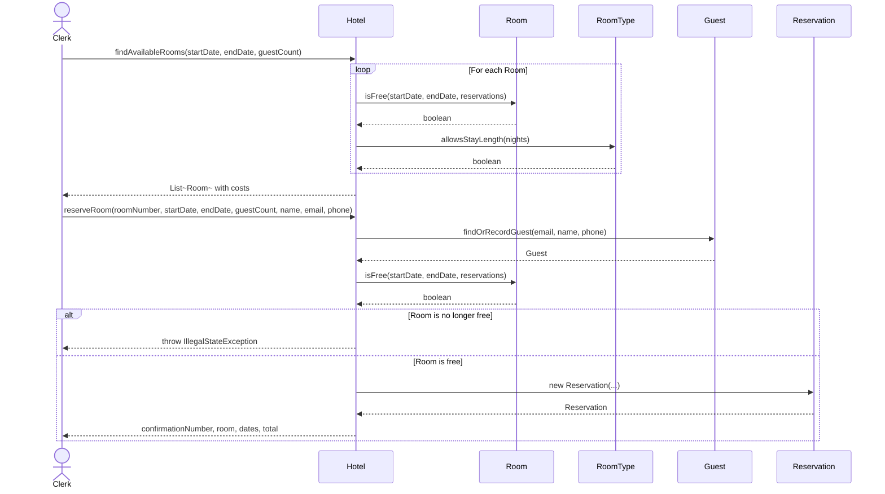
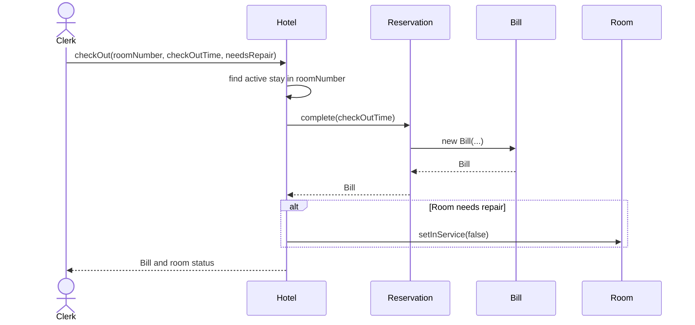

# Assignment 2: Dini Hassan

## Deliverable 1: Mapping Table

| Entity | Verdict | Becomes | If no class, where it went |
| --- | --- | --- | --- |
| Guest | one class | `Guest` | --- |
| Room Type | one class | `RoomType` | --- |
| Room | one class | `Room` | --- |
| Reservation | one class | `Reservation` | --- |
| Stay | one class | `Stay` | --- |
| Bill | one class | `Bill` | --- |

## Deliverable 2: Class Model

### Class Diagram

### Responsibilities

Hotel: I made the Hotel class responsible for coordinating front desk operations because it acts as the central hub where the clerk looks up rooms, manages guests, and tracks reservations.
RoomType: I gave RoomType the job of holding rate terms and stay constraints so that we don't duplicate pricing logic across individual rooms.
Room: Room is responsible for knowing its physical location and figuring out whether it's free for a given date range by checking existing reservations.
Guest: Guest is simply responsible for holding the visitor's contact info so the system can look them up or create a new profile.
Reservation: Reservation handles the booked date range, keeps track of the rates locked in on the day it was made, and manages its own lifecycle status.
Stay: Stay is responsible for recording the exact timestamps of when the guest actually arrives and departs.
Bill: Bill takes the completed reservation and works out the total amount owed based on the booked nightly rates.
ReservationStatus: An enum responsible for keeping track of the current state of a reservation (confirmed, canceled, checked in, or completed).

I made the assumption that we don't need a class hierarchy or interface for room types because standard rooms, deluxe rooms, and suites all share the exact same behavior and only differ by some attributes like rates and capacities, which are cleanly turned into parameters inside RoomType.

## Deliverable 3: Sequence Diagrams

### UC-1: Reserve a Room

### UC-4: Check Out

## Deliverable 4: Responsibility Table

| Job | Owner | Method | Data it needs, and the class that holds it |
| --- | --- | --- | --- |
| Find a guest by email, or record a new guest | `Hotel` | `findOrRecordGuest(name: String, email: String, phone: String): Guest` | email, name, phone: passed from clerk; existing guest list: `Hotel` |
| say whether a room is free for every night of a date range | `Room` | `isFree(startDate: LocalDate, endDate: LocalDate, reservations: List~Reservation~): boolean` | room number: `Room`; existing reservations: `Hotel` |
| Find every room that is in service, holds a given number of guests, allows a stay that long, and is free for a date range | `Hotel` | `findAvailableRooms(startDate: LocalDate, endDate: LocalDate, guestCount: int): List~Room~` | room list, reservation list: `Hotel` |
| say what one night cots for a room type on a given date, at today’s rates | `RoomType` | `getRateForDate(date: LocalDate): int` | weekdayRate, weekendRate: `RoomType`; date: parameter |
| say whether a stay is long enough for a room type | `RoomType` | `allowsStayLength(nights: int): boolean` | minimumNights: `RoomType`; nights: parameter |
| record the rate booked for each night of a new reservation | `Reservation` | `recordRates(madeOn: LocalDate): void` | start/end dates: parameter; room type rates: `RoomType` |
| Find a reservation by its confirmation number | `Hotel` | `findReservation(confirmationNumber: String): Reservation` | confirmation number: parameter; reservation list: `Hotel` |
| Work out what a guest owes at check-out | `Bill` | `calculateTotal(): int` | rateBookedForEachNight map: `Reservation` |

## Deliverable 7: Reflection

In the beginning, I made the assumption that getRateForDate() should live inside Room at first because rooms are what guests actually book and pay for. But as I worked through the sequence diagrams, I realized that keeping pricing logic on Room meant bypassing RoomType, which the reference model explicitly assigns to own weekday and weekend rates. Moving getRateForDate() to RoomType made much more sense once I understood that pricing rules belong directly to the room type category rather than individual physical doors.

I'm still a bit unsure about my decision to store booked rates directly inside Reservation instead of keeping a reference to the RoomType version at the time of booking. The alternative was linking reservations to objects that hold the historical rate.