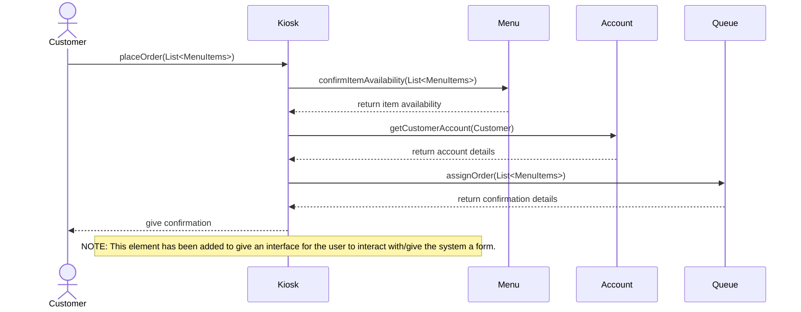

# Individual Sketch ��� Week 7
**Student:** Dini Hassan
**Date:** 10/8/26
---

## 1. Tonight's Prompt

**Step 1: The sequence diagram.** One Mermaid `sequenceDiagram` for the **main flow** of your use case. Leave the alternative flows out. Every arrow follows these rules:

1. The actor is an `actor`. Every class is a `participant`, named exactly as it is in your class diagram.
2. The actor's first arrow goes to the class in your model that should receive the request.
3. Every solid arrow (`->>`) is a method call, labeled `methodName(arguments)`. **The method must already exist on the class the arrow points to**, in your class diagram.
4. **A class can only call a class it's connected to by a line in your class diagram.**
5. Every method that returns something gets a dashed return arrow (`-->>`) labeled with what comes back.
6. When rule 3 or rule 4 fails, draw the arrow you need anyway and put a `MISSING` note directly under it: the method you propose, with its full signature, and why that class.

---

## 2. What I'm Not Sure About

I'm not sure if the Kiosk is the element I want the customer interacting with, but it works as a convenient stand-in until a specific means for the customer to place an order with is given. 

---

**Commit this file before group discussion begins.**

    